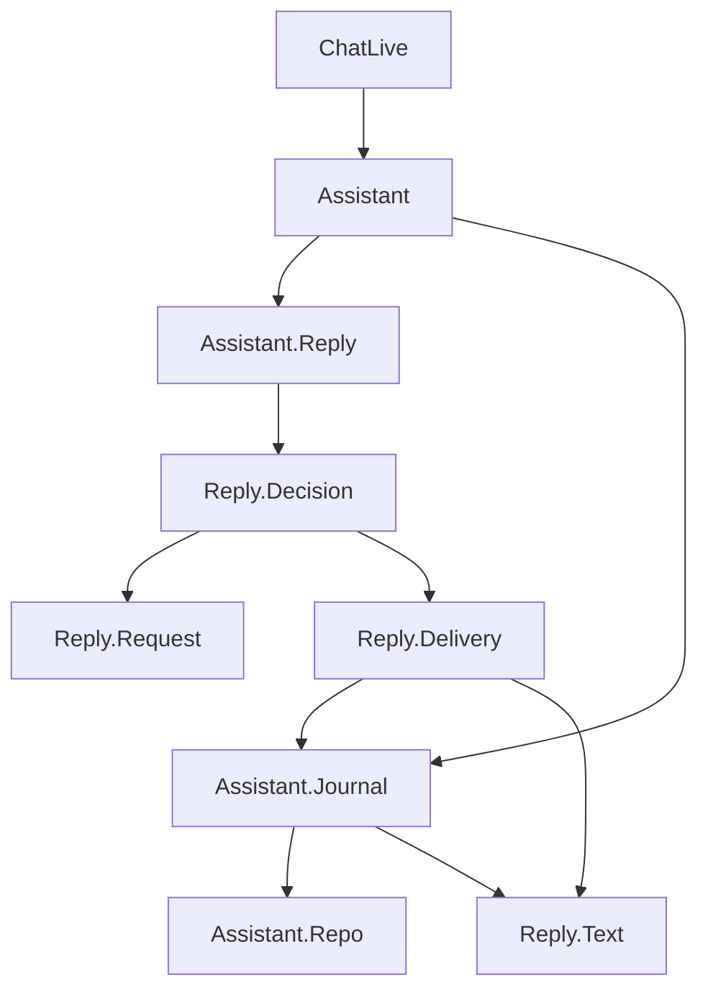

# assistant

Приложение `:assistant` хранит чаты и проводит ответы модели. Веб (`assistant_web`) и запросы к Gemini (`assistant_inference`) живут в соседних приложениях зонтика. Снаружи сюда заходят через модуль `Assistant`.

У каждого чата, в котором сейчас пишется ответ, свой процесс `Assistant.Reply`. Он регистрируется под `chat_id`. Вторая вкладка того же чата находит этот процесс. Другой чат получает другой процесс. Страница сама помнит, какой чат она открыла. История лежит в журнале, не в процессе хода.

## Кто кого вызывает



Канал `assistant:chat:<id>` несёт куски ответа и фазу этого чата. Канал `assistant:chats` сообщает, что список чатов изменился.

## Что стартует

`Assistant.Application` поднимает:

1. `Assistant.Repo` — соединение с SQLite.
2. `Assistant.Repo.Migrator` — миграции, провайдер `gemini`, обрыв недописанных ответов после падения. Процесс завершается.
3. `Assistant.Reply.Registry` — имена процессов хода по `chat_id`.
4. `Assistant.Reply.Supervisor` — запускает ход на время ответа и не поднимает его заново.
5. `Phoenix.PubSub` под именем `Assistant.PubSub`.
6. `Task.Supervisor` под именем `Assistant.TaskSupervisor`.

## Структура

```
lib/assistant.ex                  фасад
lib/assistant/application.ex      постоянные процессы
lib/assistant/journal.ex          запись и чтение базы
lib/assistant/journal/chat.ex     таблица chats
lib/assistant/journal/message.ex  таблица messages
lib/assistant/journal/provider.ex таблица provider
lib/assistant/reply.ex             почтовый ящик ответа
lib/assistant/reply/decision.ex    начать, повторить, закрыть или оборвать
lib/assistant/reply/request.ex     тело запроса к Gemini
lib/assistant/reply/delivery.ex    база, страница, таймер записи
lib/assistant/reply/text.ex        склейка кусков и заголовок чата
lib/assistant/repo.ex             репозиторий Ecto
lib/assistant/repo/migrator.ex    миграции при старте
priv/repo/migrations/             файлы миграций
```

Ход хранит фазу, `turn_id`, буфер текста, задачу стрима, число попыток и срок. Черновик и выбранный чат вкладки живут в `ChatLive`.
