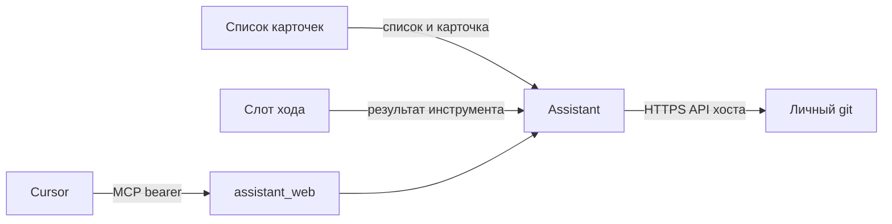

# Карточки памяти

Зафиксировано 17 ноября 2026. Требования и технический план. Журнал чатов, слот хода и протокол модели здесь не переопределяются. [web.analysis.md](../web.analysis.md), [gemini.analysis.md](../gemini.analysis.md) и [local.analysis.md](../local.analysis.md) этим файлом не правятся: карточки и MCP туда не входят.

Байты — личный git-репозиторий markdown. Heroku — дверь. Агент в репозиторий не ходит.

## Форма

Файл `cards/<slug>.md`. Другие пути дверь не пишет.

```yaml
---
title: GenServer
tags: [otp, elixir]
source: clinker
---
```

Дальше тело markdown. `slug` — имя файла, `[a-z0-9-]`, до 64 символов. После создания не меняется. `title` обязателен. Тело непустое и короче 32 КБ. `tags` — список таких же коротких токенов, до 32 штук, может быть пустым. `source` обязателен на создании (`clinker` или короткое имя проекта) и при обновлении остаётся. Чужой ключ шапки — отказ. Время присылает git-коммит, не агент. Ссылка `[[slug]]` в теле может указывать на карточку, которой ещё нет.

## Правила для агента

Контракт — MCP-сервер. Его `instructions` и схемы четырёх инструментов читают и Cursor, и чат на Heroku. `AGENTS.md`, rules проекта и `prompts/system.md` карточки не описывают и этой фичей не правятся.

Агент файл с шапкой не сочиняет. Он вызывает `create_card` или `update_card` полями. Путь `cards/<slug>.md` и YAML пишет дверь.

Текст правил один, его автор — сервер:

- Cursor получает его по HTTP при инициализации MCP и в описаниях инструментов.
- Чат на том же узле спрашивает тот же сервер и кладёт этот ответ в вызов провайдера. Второй формулировки у слота нет. На `/mcp` по HTTP слот не ходит: сервер и слот в одном узле, запись идёт в дверь функцией.

Правила полей:

- `title` — имя предмета одной строкой: `GenServer`. Не абзац и не slug.
- `tags` — токены тем, `[a-z0-9-]`: `otp`, `elixir`. Не фразы и не повтор заголовка.
- `body` — markdown: о чём карточка, какое решение, ссылки `[[slug]]`. Строк `---` в теле нет.
- `slug` — латинское имя файла.
- `source` — `clinker` или имя проекта, из которого пришёл разговор.

Поле вне этих правил — отказ, в ответе тот же текст сервера. В репозиторий такая запись не попадает. Поменять формулировку — поменять сервер. Следующий ход чата и следующее подключение Cursor видят уже её.

## Граф

Узла помимо файла нет. Тег — строка в шапке. Ребро карточка—тег берётся из `tags`. Ребро карточка—карточка берётся из `[[slug]]`. Отдельной графовой базы нет.

## Операции

Четыре: список, одна карточка, создать, обновить. Удаления нет: ни инструмента, ни функции двери, ни кнопки, ни коммита, который стирает файл.

Создать существующий slug — отказ, файл не меняется. Обновить отсутствующий slug — отказ. Битый файл виден в списке как битый. Починить его может успешный update.

Запись — один коммит на одну карточку. Сообщение коммита фиксированное: `card: create <slug>` или `card: update <slug>`. Агент текст коммита не задаёт. Коммит без успешного push успехом не считается.

## Чтение

Агент и экран вызывают список. Ответ берётся из индекса в памяти процесса.

Запись индекса: slug, title, tags, source, исходящие `[[slug]]`, признак битого файла. Тел в индексе нет. Ключ поиска — тег, значение — список slug. Несколько тегов — пересечение списков: карточка подходит, когда на ней есть каждый из них. Пустой фильтр — все заголовки.

Индекс строится чтением шапок с диска клона. Два повода: старт процесса и fetch, который принёс чужие коммиты. Своя запись меняет одну запись индекса и остальные файлы не перечитывает.

Тысяча карточек. Шапка — сотни байт. Типичное тело — пара килобайт, потолок — 32 КБ. Клон на тысячу типичных карточек — единицы мегабайт. Сборка индекса — одна пачка чтений локальных файлов, ожидаемо меньше секунды. Следующий фильтр по тегу — выборка из карты. Первый запрос после старта ждёт сборку, если её ещё нет.

`list_cards` отдаёт заголовки. `get_card` читает один файл с диска клона. Модель за ход открывает не больше трёх карточек, поэтому тысяча совпадений не превращается в тысячу тел в контексте.

Fetch — один разговор с remote, когда клон отстал от него. На каждый поиск fetch не запускается и отдельный запрос на каждый файл не делается. Поиск по тексту тела в эту фичу не входит: для него индекса нет.

Входящие ссылки одной карточки считаются по индексу исходящих, без обхода git.

## Кто пишет и кто читает

Пишут двое, оба в одну дверь на Heroku.

- Cursor — HTTP MCP с bearer. Правила берёт из `instructions` и схем сервера.
- Модель в чате — те же `instructions` и схемы, спрошенные у этого сервера на узле. Function call слот выполняет дверью.

Очередь одного процесса выполняет одну запись до успешного push, следующая ждёт. После push индекс уже содержит эту карточку, и следующий список второго агента её видит. Своего клона у агента нет, pull ему не нужен.

Update присылает карточку целиком. Дверь пишет этот файл как есть и diff двух тел не считает. Два update одного slug идут друг за другом: в репозитории остаётся тело последней успешной записи. Кто прочитал карточку до чужого update и записал старое тело поверх, затирает промежуточную правку.

Fetch нужен, когда remote ушёл вперёд без этой двери, например правка владельца руками. Дверь подтягивает remote. Если за это время изменился тот же файл, запись отказывается, агент читает карточку заново. Два markdown в один файл сами не склеиваются.

Экран читает той же дверью и модель не вызывает. Модель не получает хранилище на каждом ходе: только результат своих вызовов в этом ходе. В журнал чата пишется итоговый текст ответа. Тела карточек в сборку следующего хода не копируются.

Инструменты объявляются провайдеру, который умеет function call. Локальная модель без этого карточку не пишет. Ход не сообщает об успехе, если дверь успех не вернула.

Репозиторий карточек недоступен — чат и журнал работают. Список показывает, что хранилище недоступно.

## Экран

Новый маршрут, только чтение. Список: slug, заголовок, теги, source. Поиск по тегам. Открытая карточка: тело и ссылки `[[slug]]`. Формы создания и правки нет.

## Доступ

`CARDS_REPO_URL` и `CARDS_GIT_TOKEN` живут в конфигурации Heroku. В Cursor их нет. `MEMORY_MCP_TOKEN` — bearer MCP, его держит личная настройка Cursor. Оба токена в git приложения и в git рабочих проектов не коммитятся. В [.cursor/mcp.json](../.cursor/mcp.json) этого репозитория сервер карточек не добавляется.

Пустой MCP-токен закрывает вход. Неверный токен — отказ без текста карточек. Git-токен позволяет обойти дверь и стереть файл руками. Поэтому он остаётся у владельца и на Heroku, агентам не выдаётся.

Один web-процесс на узел, как у слота. Записи карточек сериализует один процесс: два коммита не перемешиваются.

Кэш на Heroku — два слоя этого dyno, без аддона и без Postgres. Каталог `/tmp/cards` процесс заполняет при старте одним архивом репозитория по HTTPS и дальше читает файлы с диска. Коммит на диске не собирается: процесс отправляет хосту один новый коммит с одним файлом и затем обновляет этот файл в `/tmp/cards` и в индексе. Индекс тегов лежит в памяти процесса. Правда — remote. Деплой, рестарт и суточный цикл dyno стирают и каталог, и память. Поднявшийся процесс снова забирает архив и собирает индекс. Второй dyno получил бы свой `/tmp`, поэтому web-процесс один.

## Технический план



| Что | Где |
| --- | --- |
| Файлы карточек | Личный git, каталог `cards/` |
| Индекс тегов и ссылок | Память процесса в `assistant`. Файлы в `/tmp/cards` — кэш с архива |
| Дверь | `Assistant`: список, карточка, создать, обновить |
| HTTP MCP | `assistant_web`, внутрь только `Assistant` |
| Function call | `assistant_inference`. Git и журнал ему неизвестны |
| Правила полей | Только MCP-сервер: `instructions` и схемы инструментов. Ими пользуются Cursor и чат |
| Журнал чатов | Не хранит карточки |

Дверь:

```elixir
list_cards(tags)
get_card(slug)
create_card(slug, title, tags, source, body)
update_card(slug, title, tags, body)
```

MCP публикует эти четыре инструмента и ни одного больше. Контракт remote по HTTPS: одним запросом забрать архив `cards/`, одним запросом создать коммит с одним файлом, файл не удалять. Бинарник `git` на dyno не ставится. Slug приложения его не содержит, и агент команд `git` не выполняет. Коммит создаёт процесс двери через API хоста: текущий кончик ветки, новый файл, новый коммит, сдвиг ветки. В истории репозитория это обычный коммит. Обход файлов через API по одному на каждый поиск контракту не удовлетворяет: после архива индекс живёт в памяти.

Правка заденет три приложения. Экран и HTTP MCP — `assistant_web`. Хранилище, дверь и текст контракта — `assistant`. Слот передаёт контракт сервера провайдеру через `assistant_inference`. `AGENTS.md` и `prompts/system.md` не меняются.

## Гайд

Подготовка владельца. Рабочий проект и репозиторий приложения этим не становятся.

Репозиторий — новый и приватный, отдельно от clinker и от рабочих проектов. В нём ветка `main` и каталог `cards/`. Имя, например, `memory-cards`. URL вида `https://github.com/<владелец>/memory-cards`.

Три секрета:

| Имя | Где создаётся | Куда кладётся |
| --- | --- | --- |
| `CARDS_REPO_URL` | адрес этого репозитория | только Heroku |
| `CARDS_GIT_TOKEN` | токен хоста на один этот репозиторий, чтение и запись файлов | только Heroku |
| `MEMORY_MCP_TOKEN` | длинная случайная строка владельца | Heroku и личная настройка MCP в Cursor |

На GitHub токену достаточно одного репозитория и права Contents на чтение и запись. Токен в Cursor не копируется: им процесс на dyno создаёт коммит. Удалять файлы приложение не вызывает, но сам токен это может, поэтому он остаётся на Heroku.

В Cursor, в личных настройках MCP, не в файле проекта:

```json
{
  "mcpServers": {
    "memory-cards": {
      "url": "https://<приложение>.herokuapp.com/mcp",
      "headers": {
        "Authorization": "Bearer <MEMORY_MCP_TOKEN>"
      }
    }
  }
}
```

Проверка: «покажи карточки», затем «заведи карточку» с тегом. В репозитории появляется `cards/<slug>.md` одним коммитом, в списке приложения — строка с этим тегом. В тело не класть ключи. Сосед по рабочему репозиторию эту настройку из клона проекта не получает.

## Вне фичи

Полнотекстовый поиск, переименование, удаление, вторая база, графовая СУБД, правка трёх старых брифов, подстановка карточек в каждый ход, копия правил в `AGENTS.md`, в rules проекта и в `prompts/system.md`.
