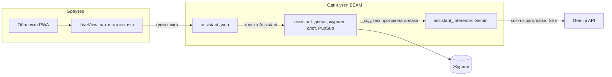

# Gemini

Зафиксировано 9 ноября 2026. Требования облачной модели и того, что для неё добавляется к веб-клиенту из `web.analysis.md`. Окно локальной модели, токенизатор, прунер и видеокарта здесь не участвуют.

## Бэкенд

Модуль `AssistantInference.Gemini`. Слот не разбирает протокол облака. Наружу модуль отдаёт те же события, что ждёт веб: кусок рассуждения, кусок текста, в конце `prompt_tokens` и `eval_tokens`.

Запрос — `streamGenerateContent` с `alt=sse`. Тело ответа — строки `data: {json}`. Рассуждение приходит частями с пометкой мысли, текст — отдельными частями. Пустая часть одно поле другим не затирает. Счётчики берутся из `usageMetadata` и пишутся в поля строки хода. Повтор после обрыва считает вход ещё раз: облако эту работу сделало, в «потрачено» она входит. Пустые текст и рассуждение при конце хода — ошибка пустого ответа.

Ключ на машине читается из файла `gemini.key` в корне репозитория. Файла нет в git. На хосте файла нет, тот же модуль читает `GEMINI_API_KEY`, заданную до старта. Поле на статистике переменную хоста не подменяет. В `assistant.json`, в URL, в журнал и в лог ключ не попадает. Ключ уходит только заголовком. Пустой файл, отсутствие файла и пустая переменная означают: провайдер недоступен, ход не стартует.

Имя модели берётся из `assistant.json`. В список облака оно должно входить.

Браузер облако не вызывает и ключ не хранит. Поток идёт с узла, куски в журнал пишет слот. Установленная оболочка PWA этого не меняет.

Доступность проверяет сам модуль: ключ есть, список моделей с этим ключом отвечает, выбранная модель в списке есть. Это не проверка локального сервера и не повод его поднимать.

В запрос уходит журнал целиком: системный промпт и все реплики дословно, поле `thinking` по-прежнему не копируется. Отдельной сборки окна у этого провайдера нет.

Обрыв потока при доступном API продолжает тот же `turn_id`, не дольше трёх попыток, как в требованиях веба. Процесс на машине человека ради этого не перезапускается. Смена чата отменяет ход и в облако его не возвращает.

Тишина между кусками дольше 120 секунд и общий предел хода 15 минут считаются обрывом. Отмена закрывает HTTP-запрос к API, а не только подписку браузера.

Пока выбран Gemini, слот зовёт только этот модуль. Падение другого канала само сюда ход не переносит.

## Архитектура

Три приложения зонтика. Экран зовёт дверь, дверь зовёт модуль, модуль зовёт облако. Журнал и слот остаются в `assistant`. Схема таблиц здесь не повторяется.



| Что | Где живёт |
| --- | --- |
| Реплики, рассуждение, статусы, токены | Журнал, источник правды для экрана |
| Фаза, `turn_id`, попытки | Слот в памяти узла |
| Выбор Gemini | Запись провайдера в журнале, переживает перезапуск |
| Ключ | `gemini.key` на машине, `GEMINI_API_KEY` на хосте. Наружу только заголовком |
| Имя модели | `assistant.json` |
| Список моделей и готовность | Модуль Gemini. Экран показывает слово, сам ключ не получает |
| Окно, прунер, видеокарта | В эту фичу не входят |

На машине журнал — SQLite, файл `apps/assistant/priv/assistant.db`. На Heroku — Postgres из `DATABASE_URL`. Диск dyno журналом не является.

## Веб-клиент

К статистике из `web.analysis.md` добавляется выбор Gemini и поле ключа. Сохранённый ключ на экран целиком не выводится: виден только признак, что ключ задан. Поле на машине пишет `gemini.key` через дверь `Assistant`. Экран не читает ни файл, ни переменную.

К двери эта фича добавляет:

```elixir
select_provider(name)
put_key(key)
provider()
```

`select_provider(:gemini)` пишет имя в запись провайдера. `put_key/1` на машине пишет файл. На хосте ключ уже в переменной, вызов его не подменяет. `provider()` отдаёт имя, признак ключа и готовность: ключ есть, список моделей ответил, выбранная модель в списке. Сам ключ не отдаёт. Слово на экране собирается из готовности и фазы слота.

Слово доступности, своё для этого провайдера:

- нет ключа или список моделей не отвечает — «недоступна»;
- список отвечает и модель в нём есть, слот в покое — «доступна»;
- слот пишет ответ — «занята».

Пока слово «недоступна», кнопка отправки молчит, над формой причина, пара хода не создаётся. Заполнения окна и видеокарты на экранах нет.

Лента, рассуждение, потраченное в чате и сумма на статистике остаются как в веб-фиче. Цифры приходят из `usageMetadata`.
